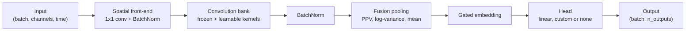

# GRF-Net: Geometry-aware Rocket-Fusion Network

[](LICENSE)
[](https://www.python.org/)
[](https://pytorch.org/)

Yes I AI generate my personal project README's

A compact PyTorch model for multichannel time series. GRF-Net combines a
learnable spatial front-end with a frozen ROCKET-style convolution bank, then
fuses several temporal statistics into an embedding for a small trainable head.

## Highlights

- **Small:** 3,847 trainable parameters for a 22-channel, 4-class problem.
- **Low-variance features:** most of the convolution bank is random and frozen.
- **Spatial filtering:** channel mixing is learned, and can be seeded from sensor positions.
- **Fusion pooling:** combines proportion of positive values (PPV), log-variance and mean.
- **Rate-adaptive:** dilations can scale with the sampling rate, keeping the feature count fixed.
- **Any input length:** one model handles sequences of different lengths.
- **Task-agnostic head:** classification, regression, multi-label output, embeddings or a custom head.

## Architecture



| Stage             | Purpose                                                                                                                       |
| ----------------- | ----------------------------------------------------------------------------------------------------------------------------- |
| Spatial front-end | Mixes input channels into `spatial_components` learned components.                                                            |
| Convolution bank  | Applies depthwise dilated kernels to each component, using frozen mean-centred random kernels and optional learnable kernels. |
| Fusion pooling    | Summarises each feature map over time with the selected statistics.                                                           |
| Gated embedding   | Weights each statistic with a learned softmax gate. `forward_features` returns this embedding.                                |
| Head              | Applies dropout, then a linear layer by default. Can be replaced or removed.                                                  |

## Installation

```bash
git clone https://github.com/Joekrry/GRFNet.git
```

```bash
cd GRFNet
```

```bash
pip install -e .
```

Requires Python 3.11 or later and PyTorch 2.2 or later. To look up EEG
electrode positions by name, also install the optional `eeg` extra, which adds
MNE-Python:

```bash
pip install -e ".[eeg]"
```

ONNX export needs the `onnx` extra, which adds onnx, onnxscript and ONNX Runtime:

```bash
pip install -e ".[onnx]"
```

## Quick start

```python
import torch
from grfnet import GRFNet

model = GRFNet(n_channels=22, n_times=1000, n_classes=4, sfreq=250.0)

x = torch.randn(8, 22, 1000)  # (batch, n_channels, n_times)
logits = model(x)             # (batch, n_classes)
```

The model returns raw logits for use with `torch.nn.CrossEntropyLoss`.

### Sampling rate and dilations

By default the convolution bank uses dilations `(1, 2, 4, 8)`. Pass `sfreq` to
treat these as values for 250 Hz and rescale them to your sampling rate, which
keeps each kernel's span in seconds roughly constant:

```python
from grfnet import GRFNet

model = GRFNet(n_channels=8, n_classes=3, sfreq=1000.0)
print(model.bank.dilations)  # [4, 8, 16, 32]
```

To set the dilations yourself, pass `dilations`. They are used as given:

```python
from grfnet import GRFNet

model = GRFNet(n_channels=8, n_classes=3, dilations=[1, 3, 9, 27, 81])
```

`n_times` is optional and only recorded on the model. Inputs of any length are
accepted.

### Training

```python
import torch
from grfnet import GRFNet

model = GRFNet(n_channels=22, n_times=1000, n_classes=4, sfreq=250.0)
optimizer = torch.optim.Adam(model.parameters(), lr=1e-3)
criterion = torch.nn.CrossEntropyLoss()

x = torch.randn(8, 22, 1000)
y = torch.randint(0, 4, (8,))

model.train()
optimizer.zero_grad()
loss = criterion(model(x), y)
loss.backward()
optimizer.step()
```

### Outputs, embeddings and custom heads

The linear head returns raw scores, so the same model serves several tasks. The
loss decides the task: `CrossEntropyLoss` for classification, `MSELoss` for
regression, or `BCEWithLogitsLoss` for multi-label output. `n_outputs` sets the
output size, and `n_classes` is an alias for it:

```python
import torch
from grfnet import GRFNet

regressor = GRFNet(n_channels=8, n_outputs=1)
tagger = GRFNet(n_channels=8, n_outputs=5)

x = torch.randn(4, 8, 256)
loss = torch.nn.functional.mse_loss(regressor(x).squeeze(1), torch.randn(4))
```

`forward_features` returns the gated embedding that the head receives. Pass
`head=None` for a feature extractor whose `forward` returns that embedding:

```python
import torch
from grfnet import GRFNet

encoder = GRFNet(n_channels=8, head=None)
embedding = encoder(torch.randn(4, 8, 256))  # (batch, encoder.embedding_dim)
```

`head` also accepts any `nn.Module`, or a function that receives
`embedding_dim` and returns one:

```python
from torch import nn
from grfnet import GRFNet

model = GRFNet(
    n_channels=8,
    head=lambda dim: nn.Sequential(nn.Linear(dim, 32), nn.ReLU(), nn.Linear(32, 3)),
)
```

### Pooling statistics

`statistics` selects how each feature map is summarised over time. The built-in
options are:

| Name       | Statistic                                                                             |
| ---------- | ------------------------------------------------------------------------------------- |
| `"ppv"`    | Differentiable proportion of positive values, with a learnable threshold per feature. |
| `"logvar"` | Log-variance. `"bandpower"` is an alias.                                              |
| `"mean"`   | Mean.                                                                                 |
| `"max"`    | Maximum.                                                                              |
| `"std"`    | Standard deviation, computed as the square root of variance plus `logvar_eps`.        |

A function that maps features of shape `(batch, n_features, n_times)` to
`(batch, n_features)` can also be used:

```python
from grfnet import GRFNet

def peak_to_peak(feats):
    return feats.amax(dim=-1) - feats.amin(dim=-1)

model = GRFNet(n_channels=8, n_classes=2, statistics=("ppv", "logvar", peak_to_peak))
```

### Reproducible kernel bank

The frozen kernels are drawn from PyTorch's global random number generator by
default. `bank_seed` draws them from a separate generator instead, so the bank
is identical across runs whatever the global seed:

```python
from grfnet import GRFNet

model = GRFNet(n_channels=8, n_classes=2, bank_seed=0)
```

### Geometry-seeded spatial filters

Pass sensor coordinates to initialise the spatial filters with smooth spatial
patterns. Coordinates can have any number of dimensions, such as positions
along a line, on a surface or in 3-D space:

```python
from grfnet import GRFNet

coords = [[0.0, 1.0], [1.0, 0.0], [0.0, -1.0], [-1.0, 0.0]]  # (n_channels, 2)
model = GRFNet(n_channels=4, n_times=1000, n_classes=2, channel_coords=coords)
```

The patterns are a gradient along each axis, then the squared distance from the
centre, products of axes and differences of squared axes. Duplicate patterns
and those that are constant across the sensors are skipped. When there are more
components than patterns, the extra components start from random weights.
`model.spatial.n_geometry_components` reports how many were seeded.

For EEG data, standard 10-20 electrode names are also accepted. This requires
the `eeg` extra:

```python
from grfnet import GRFNet

model = GRFNet(
    n_channels=4,
    n_times=1000,
    n_classes=2,
    channel_names=["C3", "Cz", "C4", "Pz"],
)
```

To seed from 3-D electrode positions, look them up first:

```python
from grfnet import GRFNet, channel_positions

names = ["Fz", "C3", "Cz", "C4", "Pz", "O1", "O2", "F3"]
model = GRFNet(n_channels=8, n_classes=2, channel_coords=channel_positions(names, ndim=3))
```

## Saving and deployment

### Checkpoints

`save` writes the model's configuration, weights and optional metadata to one
file. `load` rebuilds the model from it and returns it in eval mode:

```python
from grfnet import GRFNet, load_checkpoint

model = GRFNet(n_channels=8, n_classes=2)
model.save("grfnet.pt", metadata={"epoch": 40})

restored = GRFNet.load("grfnet.pt")
print(load_checkpoint("grfnet.pt")["metadata"])  # {'epoch': 40}
```

Checkpoints are read with `torch.load(..., weights_only=True)`. `get_config`
returns the constructor arguments as JSON-compatible values, and `from_config`
builds an untrained model from them. Custom heads and custom statistics are
Python objects and cannot be stored: for those models, rebuild the model in code
and load its `state_dict`.

### Export and compilation

| Target | How | Notes |
| --- | --- | --- |
| `torch.export` | `torch.export.export(model, (x,), dynamic_shapes=...)` | Batch size and input length can be dynamic. |
| ONNX | `export_onnx(model, "grfnet.onnx")` | Batch size and input length are dynamic by default. Needs the `onnx` extra. |
| TorchScript | `torch.jit.script(model)` | Not available with custom statistics. PyTorch no longer supports TorchScript on Python 3.14 or later. |
| `torch.compile` | `torch.compile(model)` | Compiles as a single graph. |

```python
import torch
from grfnet import GRFNet, export_onnx

model = GRFNet(n_channels=8, n_classes=2).eval()
export_onnx(model, "grfnet.onnx", n_times=256)

batch, n_times = torch.export.Dim("batch", min=1), torch.export.Dim("n_times", min=2)
program = torch.export.export(model, (torch.randn(2, 8, 256),), dynamic_shapes={"x": {0: batch, 2: n_times}})
```

The ONNX file has one input, `input`, of shape `(batch, n_channels, n_times)`,
and one output, `output`.

### Mixed precision

The model runs under `torch.autocast`, with `float16` on CUDA and `bfloat16` on
CPU.

## Configuration

| Argument              | Default                     | Description                                                                                        |
| --------------------- | --------------------------- | -------------------------------------------------------------------------------------------------- |
| `n_channels`          | required                    | Number of input channels.                                                                          |
| `n_times`             | `None`                      | Expected input length. Recorded only; inputs of any length are accepted.                           |
| `n_classes`           | `None`                      | Alias of `n_outputs`.                                                                              |
| `n_outputs`           | `None`                      | Output size of the linear head. Required unless `head` is not `"linear"`.                          |
| `head`                | `"linear"`                  | `"linear"`, `None` for embeddings, an `nn.Module`, or a function of `embedding_dim` returning one. |
| `sfreq`               | `None`                      | Sampling rate in Hz. When set, rescales `base_dilations` from 250 Hz.                              |
| `spatial_components`  | `16`                        | Number of learned spatial components.                                                              |
| `spatial_init`        | `None`                      | `"random"` or `"geometry"`. `None` uses geometry when sensor positions are supplied.               |
| `channel_names`       | `None`                      | EEG electrode names resolved against the 10-20 template. Requires the `eeg` extra.                 |
| `channel_coords`      | `None`                      | Sensor coordinates with shape `(n_channels, d)`, or `(n_channels,)` for one dimension.             |
| `kernel_length`       | `9`                         | Convolution kernel length. Must be odd.                                                            |
| `base_dilations`      | `None`                      | Dilations before rescaling. `None` uses `(1, 2, 4, 8)`.                                            |
| `dilations`           | `None`                      | Dilations used as given. Cannot be combined with `sfreq` or `base_dilations`.                      |
| `fixed_per_group`     | `2`                         | Frozen kernels per component and dilation.                                                         |
| `learnable_per_group` | `1`                         | Learnable kernels per component and dilation. `0` gives a fully frozen bank.                       |
| `statistics`          | `("ppv", "logvar", "mean")` | Pooling statistics to fuse. Names or functions.                                                    |
| `ppv_tau`             | `0.5`                       | Temperature of the differentiable PPV.                                                             |
| `ppv_bias`            | `True`                      | Learn a PPV threshold for each feature.                                                            |
| `logvar_eps`          | `1e-6`                      | Added to the variance in `"logvar"` and `"std"`.                                                   |
| `dropout`             | `0.3`                       | Dropout rate before the head.                                                                      |
| `bank_seed`           | `None`                      | Seed for the frozen kernels. `None` uses the global generator.                                     |

## Model size

Trainable parameters and frozen kernel weights with the default configuration:

| Channels | Classes | Trainable | Frozen |
| -------- | ------- | --------- | ------ |
| 3        | 2       | 2,389     | 1,152  |
| 22       | 4       | 3,847     | 1,152  |
| 64       | 10      | 7,981     | 1,152  |

Use `model.count_parameters()` to get the trainable count for any configuration.

## Testing

```bash
pip install -e ".[dev]"
```

```bash
python -m pytest
```

Tests for optional features are skipped when their extra is not installed. To
run every test, install all extras:

```bash
pip install -e ".[dev,eeg,onnx]"
```

## Citation

If you use GRF-Net in your work, please cite this repository:

```bibtex
@software{kerry2026grfnet,
  author = {Kerry, Joe},
  title  = {{GRF-Net}},
  year   = {2026},
  url    = {https://github.com/Joekrry/GRFNet}
}
```

## References

GRF-Net builds on the following work:

- A. Dempster, F. Petitjean and G. I. Webb, "ROCKET: exceptionally fast and accurate time series classification using random convolutional kernels", _Data Mining and Knowledge Discovery_ 34, 2020.
- A. Dempster, D. F. Schmidt and G. I. Webb, "MiniRocket: a very fast (almost) deterministic transform for time series classification", _KDD_, 2021.
- K. K. Ang et al., "Filter Bank Common Spatial Pattern (FBCSP) in brain-computer interface", _IJCNN_, 2008.
- R. T. Schirrmeister et al., "Deep learning with convolutional neural networks for EEG decoding and visualization", _Human Brain Mapping_ 38(11), 2017.

## Licence

Released under the [MIT License](LICENSE).
