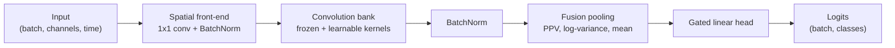

# GRF-Net: Geometry-aware Rocket-Fusion Network

[](LICENSE)
[](https://www.python.org/)
[](https://pytorch.org/)

A compact PyTorch model for multichannel time-series classification. GRF-Net
combines a learnable spatial front-end with a frozen ROCKET-style convolution bank,
then fuses several temporal statistics in a small end-to-end trainable head.

## Highlights

- **Small:** 3,847 trainable parameters for a 22-channel, 4-class problem.
- **Low-variance features:** most of the convolution bank is random and frozen.
- **Spatial filtering:** channel mixing is learned, and can be seeded from sensor positions.
- **Fusion pooling:** combines proportion of positive values (PPV), log-variance and mean.
- **Rate-adaptive:** dilations can scale with the sampling rate, keeping the feature count fixed.
- **Any input length:** one model handles sequences of different lengths.

## Architecture



| Stage | Purpose |
| --- | --- |
| Spatial front-end | Mixes input channels into `spatial_components` learned components. |
| Convolution bank | Applies depthwise dilated kernels to each component, using frozen mean-centred random kernels and optional learnable kernels. |
| Fusion pooling | Summarises each feature map over time with the selected statistics. |
| Gated head | Weights each statistic with a learned softmax gate, then applies dropout and a linear classifier. |

## Installation

```bash
git clone https://github.com/Joekrry/GRFNet.git
```

```bash
cd GRFNet
```

```bash
pip install -e .
```

Requires Python 3.11 or later and PyTorch 2.2 or later.

## Quick start

```python
import torch
from grfnet import GRFNet

model = GRFNet(n_channels=22, n_times=1000, n_classes=4, sfreq=250.0)

x = torch.randn(8, 22, 1000)  # (batch, n_channels, n_times)
logits = model(x)             # (batch, n_classes)
```

The model returns raw logits for use with `torch.nn.CrossEntropyLoss`.

### Sampling rate and dilations

By default the convolution bank uses dilations `(1, 2, 4, 8)`. Pass `sfreq` to
treat these as values for 250 Hz and rescale them to your sampling rate, which
keeps each kernel's span in seconds roughly constant:

```python
from grfnet import GRFNet

model = GRFNet(n_channels=8, n_classes=3, sfreq=1000.0)
print(model.bank.dilations)  # [4, 8, 16, 32]
```

To set the dilations yourself, pass `dilations`. They are used as given:

```python
from grfnet import GRFNet

model = GRFNet(n_channels=8, n_classes=3, dilations=[1, 3, 9, 27, 81])
```

`n_times` is optional and only recorded on the model. Inputs of any length are
accepted.

### Training

```python
import torch
from grfnet import GRFNet

model = GRFNet(n_channels=22, n_times=1000, n_classes=4, sfreq=250.0)
optimizer = torch.optim.Adam(model.parameters(), lr=1e-3)
criterion = torch.nn.CrossEntropyLoss()

x = torch.randn(8, 22, 1000)
y = torch.randint(0, 4, (8,))

model.train()
optimizer.zero_grad()
loss = criterion(model(x), y)
loss.backward()
optimizer.step()
```

### Geometry-seeded spatial filters

Pass sensor coordinates to initialise the spatial filters with smooth spatial
patterns:

```python
from grfnet import GRFNet

coords = [[0.0, 1.0], [1.0, 0.0], [0.0, -1.0], [-1.0, 0.0]]  # (n_channels, 2)
model = GRFNet(n_channels=4, n_times=1000, n_classes=2, channel_coords=coords)
```

For EEG data, standard 10-20 electrode names are also accepted:

```python
from grfnet import GRFNet

model = GRFNet(
    n_channels=4,
    n_times=1000,
    n_classes=2,
    channel_names=["C3", "Cz", "C4", "Pz"],
)
```

## Configuration

| Argument | Default | Description |
| --- | --- | --- |
| `n_channels` | required | Number of input channels. |
| `n_times` | `None` | Expected input length. Recorded only; inputs of any length are accepted. |
| `n_classes` | required | Number of output classes. |
| `sfreq` | `None` | Sampling rate in Hz. When set, rescales `base_dilations` from 250 Hz. |
| `spatial_components` | `16` | Number of learned spatial components. |
| `spatial_init` | `None` | `"random"` or `"geometry"`. `None` uses geometry when sensor positions are supplied. |
| `channel_names` | `None` | EEG electrode names resolved against the 10-20 template. |
| `channel_coords` | `None` | Sensor coordinates with shape `(n_channels, 2)`. |
| `kernel_length` | `9` | Convolution kernel length. Must be odd. |
| `base_dilations` | `None` | Dilations before rescaling. `None` uses `(1, 2, 4, 8)`. |
| `dilations` | `None` | Dilations used as given. Cannot be combined with `sfreq` or `base_dilations`. |
| `fixed_per_group` | `2` | Frozen kernels per component and dilation. |
| `learnable_per_group` | `1` | Learnable kernels per component and dilation. `0` gives a fully frozen bank. |
| `statistics` | `("ppv", "bandpower", "mean")` | Pooling statistics to fuse. `"bandpower"` is log-variance over time. |
| `ppv_tau` | `0.5` | Temperature of the differentiable PPV. |
| `ppv_bias` | `True` | Learn a PPV threshold for each feature. |
| `dropout` | `0.3` | Dropout rate before the classifier. |

## Model size

Trainable parameters and frozen kernel weights with the default configuration:

| Channels | Classes | Trainable | Frozen |
| --- | --- | --- | --- |
| 3 | 2 | 2,389 | 1,152 |
| 22 | 4 | 3,847 | 1,152 |
| 64 | 10 | 7,981 | 1,152 |

Use `model.count_parameters()` to get the trainable count for any configuration.

## Testing

```bash
pip install -e ".[dev]"
```

```bash
python -m pytest
```

## Citation

If you use GRF-Net in your work, please cite this repository:

```bibtex
@software{kerry2026grfnet,
  author = {Kerry, Joe},
  title  = {{GRF-Net}},
  year   = {2026},
  url    = {https://github.com/Joekrry/GRFNet}
}
```

## References

GRF-Net builds on the following work:

- A. Dempster, F. Petitjean and G. I. Webb, "ROCKET: exceptionally fast and accurate time series classification using random convolutional kernels", *Data Mining and Knowledge Discovery* 34, 2020.
- A. Dempster, D. F. Schmidt and G. I. Webb, "MiniRocket: a very fast (almost) deterministic transform for time series classification", *KDD*, 2021.
- K. K. Ang et al., "Filter Bank Common Spatial Pattern (FBCSP) in brain-computer interface", *IJCNN*, 2008.
- R. T. Schirrmeister et al., "Deep learning with convolutional neural networks for EEG decoding and visualization", *Human Brain Mapping* 38(11), 2017.

## License

Released under the [MIT License](LICENSE).
