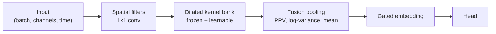

# GRF-Net: Geometry-aware Rocket-Fusion Network

[](https://github.com/Joekrry/GRFNet/actions/workflows/tests.yml)
[](LICENSE)
[](https://www.python.org/)
[](https://pytorch.org/)

GRF-Net is a compact PyTorch model for multichannel time series such as EEG. It
learns spatial filters over the input channels, optionally seeded from sensor
positions, and extracts features with a mostly frozen ROCKET-style bank of
dilated convolutions [1]. Several temporal statistics are fused through a
learned gate into an embedding for a small trainable head. The frozen bank keeps
the trainable parameter count in the low thousands.



## Results

Cross-subject classification of imagined left versus right fist movement on
EEGMMIDB [2]: 109 subjects, 5 subject-disjoint folds, 0-4 s after the cue at
160 Hz, one seed.

| Model                         | Trainable / frozen parameters | Balanced accuracy (pooled) | Per fold, mean (SD) | Per subject, mean (SD) | Cohen's kappa |
| ----------------------------- | ----------------------------- | -------------------------- | ------------------- | ---------------------- | ------------- |
| GRFNet                        | 3,365 / 1,152                 | 0.698                      | 0.699 (0.040)       | 0.700 (0.128)          | 0.395         |
| GRFNet + Euclidean alignment  | 3,365 / 1,152                 | 0.742                      | 0.742 (0.035)       | 0.742 (0.123)          | 0.483         |
| GRFNet, final (3 seeds)       | 3,365 / 1,152                 | 0.805 (SD 0.009)           | 0.805 (0.023)       | 0.805 (0.118)          | 0.611         |

Chance is 0.50. Config: [`configs/grfnet_eegmmidb_imagery_lr.toml`](configs/grfnet_eegmmidb_imagery_lr.toml);
the second row adds `--set data.normalize=euclidean`, and the final row also
`--set data.tmin=0.5` (a 0.5–4 s window) and reports the mean over seeds 0–2.
The settings were chosen by validation score in one-setting ablations. Adding
max pooling and dilations 1, 2, 4, 8 gives 0.808 (SD 0.003), no different, so
the simpler configuration is kept. All ablations and the other EEGMMIDB tasks
are in the [GRFNet README](src/grfnet/models/grfnet/README.md#ablations).
See [Reproducing the results](#reproducing-the-results).

Baselines, mean over seeds 0–2, with braindecode's default hyperparameters
and GRFNet's training protocol, on each input:

| Model                                        | Trainable parameters | MFLOPs per trial | Baseline input (0–4 s) | Final input (alignment, 0.5–4 s) |
| -------------------------------------------- | -------------------- | ---------------- | ---------------------- | -------------------------------- |
| GRFNet                                       | 3,365                | 3.5 / 3.1        | 0.706 (SD 0.009)       | 0.805 (SD 0.009)                 |
| [EEGNet](src/grfnet/models/eegnet/README.md) | 2,770                | 43 / 38          | **0.825** (SD 0.004)   | 0.781 (SD 0.003)                 |
| [ShallowConvNet](src/grfnet/models/shallowconvnet/README.md) | 106,482 | 79 / 69      | 0.819 (SD 0.004)       | 0.729 (SD 0.012)                 |

On the final input, GRFNet is ahead of EEGNet (+0.023, p = 0.004) and
ShallowConvNet (+0.076, p < 0.001). That input was selected for GRFNet,
however, and lowers both baselines' accuracy. Compared at each model's best
input, EEGNet is more accurate than GRFNet by 0.021 (p < 0.001), and
ShallowConvNet does not differ from it (−0.015, p = 0.11). GRFNet needs about
14 times fewer operations than EEGNet and 25 times fewer than ShallowConvNet.

The GRF-Net variants, on the same final input (alignment, 0.5–4 s), mean over
seeds 0–2:

| Model                                  | Trainable parameters | Balanced accuracy (pooled) | Cohen's kappa | vs GRFNet final, per subject |
| -------------------------------------- | -------------------- | -------------------------- | ------------- | ---------------------------- |
| FastGRFNet, writes off                 | 3,365                | 0.802 (SD 0.004)           | 0.604         | −0.003, p = 0.50             |
| FastGRFNet, unsupervised writes        | 8,118                | 0.737 (SD 0.006)           | 0.474         | −0.068, p < 0.001            |
| FastGRFNet, label feedback †           | 8,214                | 0.834 (SD 0.007)           | 0.667         | +0.030, p < 0.001            |
| GRFNetSeq, last time step              | 3,365                | 0.616 (SD 0.006)           | 0.232         | −0.190, p < 0.001            |
| GRFNet2d                               | 3,077                | 0.603 (SD 0.003)           | 0.206         | −0.203, p < 0.001            |

† Uses each test trial's label after predicting it. Its gain comes from the
predictable alternation of EEGMMIDB's cues, not from adaptation; see the
[FastGRFNet README](src/grfnet/models/fastgrfnet/README.md#results). Details for
each model are in its README.

## Installation

```bash
git clone https://github.com/Joekrry/GRFNet.git
cd GRFNet
pip install -e ".[eeg,viz,eval]"
```

Python 3.11+ and PyTorch 2.2+. The core package needs only PyTorch and NumPy.

| Extra  | Adds                           | For                                              |
| ------ | ------------------------------ | ------------------------------------------------ |
| `eeg`  | MNE-Python, tqdm               | Electrode positions, dataset loading, progress   |
| `viz`  | Matplotlib, scikit-learn       | Dataset and run reports                          |
| `eval` | SciPy                          | Wilcoxon tests between runs                      |
| `onnx` | onnx, onnxscript, ONNX Runtime | ONNX export                                      |
| `baselines` | braindecode               | EEGNet and ShallowConvNet baselines (PyTorch 2.6+) |
| `dev`  | pytest, Ruff                   | Tests and linting                                |

## Quick start

```python
import torch
from grfnet import GRFNet

model = GRFNet(n_channels=22, n_times=1000, n_classes=4, sfreq=250.0)
logits = model(torch.randn(8, 22, 1000))  # (batch, n_classes)
```

Regression, embeddings, custom heads, pooling statistics and geometry-seeded
filters are covered in the [GRFNet README](src/grfnet/models/grfnet/README.md).

## Reproducing the results

1. Download [EEGMMIDB](https://physionet.org/content/eegmmidb/1.0.0/) into
   `src/dataset/files` (or set `GRFNET_EEGMMIDB` to its folder).
2. Train, evaluate and report:

```bash
python -m grfnet.data report --cache-dir runs/cache                  # dataset figures (optional)
python -m grfnet.train configs/grfnet_eegmmidb_imagery_lr.toml              # 5-fold cross-subject training
python -m grfnet.report runs/grfnet_eegmmidb_imagery_lr              # figures, tables, benchmark
python -m grfnet.evaluate --compare runs/grfnet_eegmmidb_imagery_lr runs/<other run>   # paired Wilcoxon test
```

Each run writes its config, splits, environment, logs, checkpoints, predictions
and metrics to `runs/{model}_{dataset}_{task}/`. The report adds training curves, confusion
matrix, per-subject scores, spatial patterns, kernel frequency responses,
stream gates, embeddings, saliency and an efficiency benchmark. Details:
[datasets](src/grfnet/data/README.md), [experiments](src/grfnet/experiments/README.md).

## Models

| Model                                        | Mechanism                                                         | Output                  |
| -------------------------------------------- | ----------------------------------------------------------------- | ----------------------- |
| [GRFNet](src/grfnet/models/grfnet/README.md) | Spatial filters, frozen and learnable dilated kernels, gated pooling | One vector per sequence |
| [FastGRFNet](src/grfnet/models/fastgrfnet/README.md) | GRFNet whose spatial filters adapt within a subject's trial sequence through fast weights | Class scores and a state |
| [GRFNetSeq](src/grfnet/models/grfnetseq/README.md) | Causal GRFNet with sliding-window statistics, streamed chunk by chunk | Class scores at every time step |
| [GRFNet2d](src/grfnet/models/grfnet2d/README.md) | GRFNet on log-power spectrograms, electrodes as image channels, 2-D kernel bank | Class scores |
| [EEGNet](src/grfnet/models/eegnet/README.md) | Baseline: temporal, depthwise spatial and separable convolutions (braindecode) | Class scores |
| [ShallowConvNet](src/grfnet/models/shallowconvnet/README.md) | Baseline: temporal and spatial convolution, log band power (braindecode) | Class scores |

The baselines train, checkpoint and report through the same pipeline, with
configs `configs/eegnet_eegmmidb_imagery_lr.toml` and
`configs/shallowconvnet_eegmmidb_imagery_lr.toml`. `load_model` rebuilds any of
the three from a checkpoint.

## Deployment

```python
import torch
from grfnet import GRFNet, export_onnx

model = GRFNet(n_channels=8, n_classes=2)
model.save("grfnet.pt", metadata={"epoch": 40})   # config + weights, loaded with weights_only=True
model = GRFNet.load("grfnet.pt")                   # returns the model in eval mode

export_onnx(model, "grfnet.onnx", n_times=256)     # dynamic batch and length; needs the onnx extra
```

GRFNet also supports `torch.export` with dynamic batch and length,
`torch.compile` as a single graph, TorchScript (not on Python 3.14+), and
`torch.autocast`.

## Repository structure

```text
configs/              experiment configs
src/grfnet/
  models/grfnet/      GRFNet model
  models/fastgrfnet/  FastGRFNet (fast-weight spatial filters)
  models/grfnetseq/   GRFNetSeq (causal, streaming)
  models/grfnet2d/    GRFNet2d (spectrograms)
  models/eegnet/, models/shallowconvnet/   baselines (braindecode wrappers)
  layers.py           spatial front-end, kernel bank, dilation scaling
  data/               EEGMMIDB loader and dataset report
  experiments/        configs, splits, metrics, training runner, episodic training
  reporting/          run reports and efficiency benchmark
  train.py, evaluate.py, report.py   command-line entry points
tests/                unit tests and reference outputs
```

Run `python -m pytest` and `ruff check .` after `pip install -e ".[dev]"`.

## Citation

```bibtex
@software{kerry2026grfnet,
  author  = {Kerry, Joe},
  title   = {{GRF-Net: Geometry-aware Rocket-Fusion Network}},
  version = {0.1.0},
  year    = {2026},
  url     = {https://github.com/Joekrry/GRFNet}
}
```

## References

1. Dempster, A., Petitjean, F. and Webb, G. I. (2020). ROCKET: exceptionally
   fast and accurate time series classification using random convolutional
   kernels. *Data Mining and Knowledge Discovery*, 34, 1454-1495.
2. Schalk, G. et al. (2004). BCI2000: a general-purpose brain-computer
   interface (BCI) system. *IEEE Transactions on Biomedical Engineering*,
   51(6), 1034-1043.

## Licence

[MIT](LICENSE). Changes are listed in [CHANGELOG.md](CHANGELOG.md).
